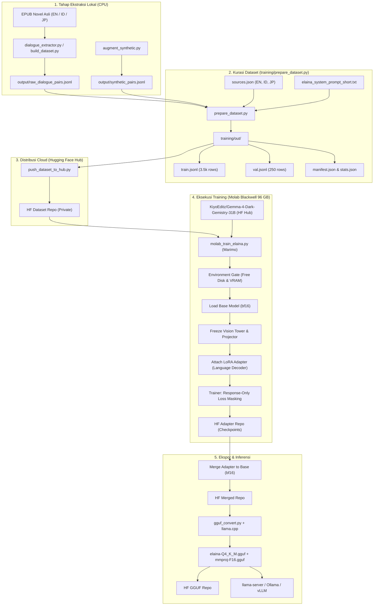
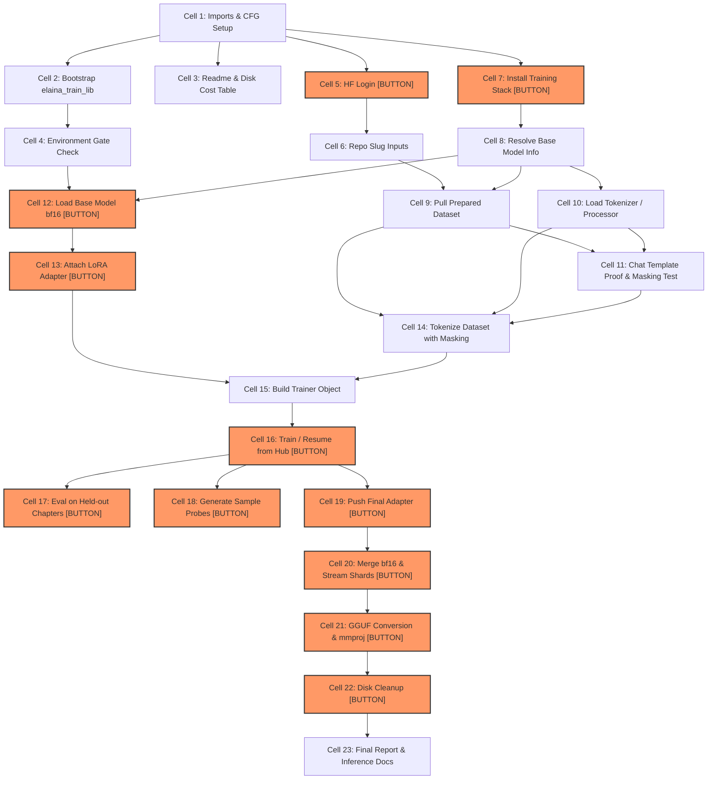
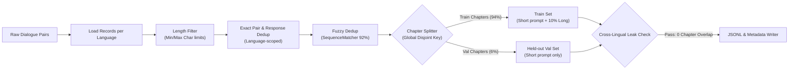
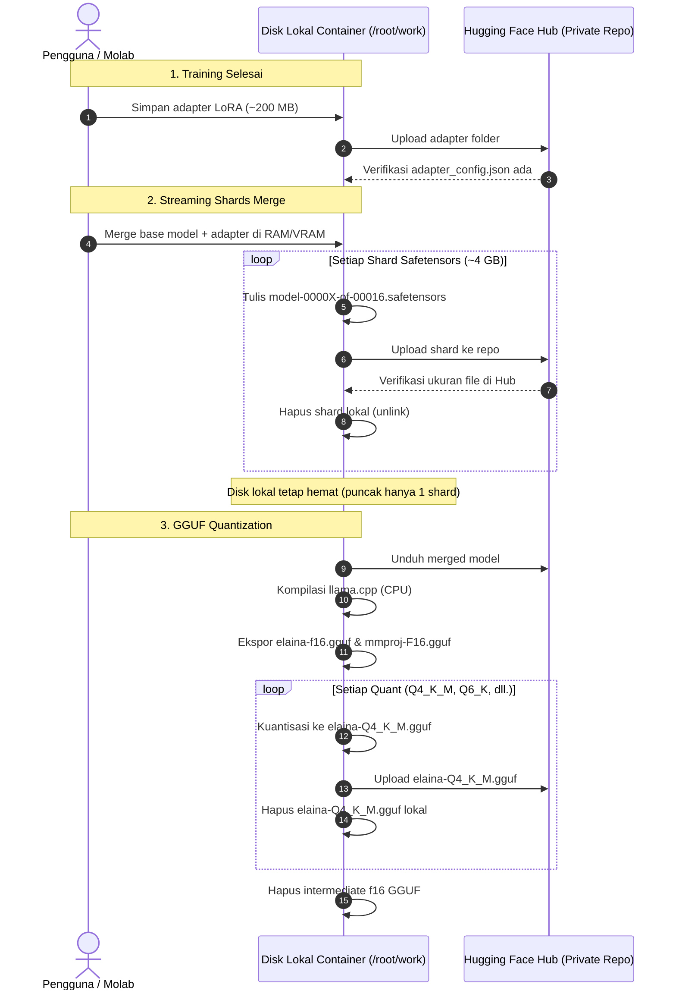
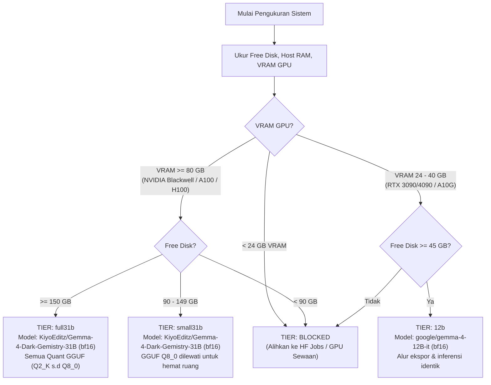
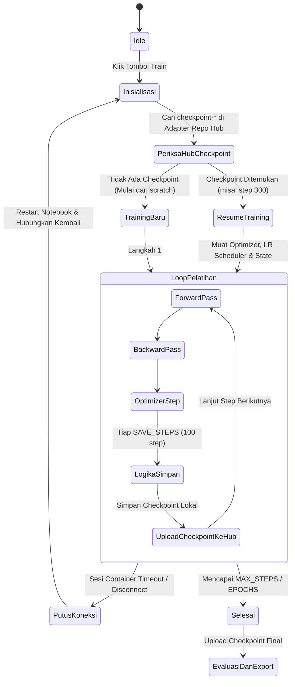

# 01 — Peta Alur & Diagram Sistem (Map Cara)

Dokumen ini memvisualisasikan seluruh alur kerja, arsitektur data, ketergantungan antar-komponen, dan siklus hidup artefak pada sistem fine-tuning persona Elaina.

---

## 1. Peta Alur Utama (End-to-End Pipeline)

Diagram berikut memperlihatkan alur data dari file ekstraksi novel mentah hingga deployment model siap pakai:

---

## 2. Peta Ketergantungan Cell Notebook Marimo (`molab_train_elaina.py`)

Notebook Marimo dijalankan secara reaktif sebagai *Directed Acyclic Graph* (DAG). Cell dengan tombol (`mo.ui.run_button`) memerlukan pemicu manual untuk mencegah pemborosan GPU:

---

## 3. Peta Pemrosesan Data & Split Anti-Bocor (`prepare_dataset.py`)

Bagaimana dialog mentah disaring dan dipisahkan menjadi train dan validation secara *disjoint*:

---

## 4. Peta Siklus Hidup Memori & Bounded-Disk Hub Sync

Mekanisme perlindungan kapasitas disk pada model 62,5 GB di volume 150 GB:

---

## 5. Pohon Keputusan Environment Gate & Hardware Tier

Aturan otomatis penentuan jalur model berdasarkan sumber daya mesin:

---

## 6. State Machine: Checkpointing & Resume Pelatihan

Alur penanganan sesi yang terputus di Molab:

