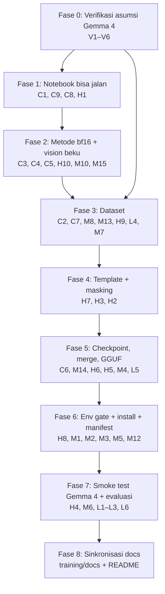

# Rencana Perbaikan `training/` — Dokumen Utama (untuk AI eksekutor)

> **Untuk siapa dokumen ini:** AI (atau engineer) yang akan **mengeksekusi** perbaikan.
> Dokumen ini adalah *rencana kerja*. Detail masalah dan perbaikan setiap item ada di
> file komponen yang ditautkan. Kerjakan berurutan per fase.

- Tanggal audit: 2026-11-07
- Sumber requirement: [`lora_gemma_elaina_qa.txt`](../../../lora_gemma_elaina_qa.txt)
- Kode yang diaudit: semua file di [`training/`](../../)
- Metode target (keputusan user): **LoRA bf16 tanpa QLoRA**, GPU NVIDIA Blackwell 96 GB, vision tower **dibekukan**.

---

## 1. Aturan untuk AI eksekutor

1. **Jangan mengubah pipeline ekstraksi** di root repo (`dialogue_extractor.py`, `build_dataset.py`, dll.). Lingkup kerja hanya `training/`.
2. Pertahankan komentar dan docstring yang tidak terkait perubahan.
3. Setiap item punya **kriteria selesai**. Item belum selesai sebelum kriterianya terbukti (perintah verifikasi dijalankan, output dicatat).
4. Item bertanda **[VERIFIKASI DULU]** bergantung pada fakta Gemma 4 yang belum dipastikan. Jalankan dulu snippet di **Fase 0**, lalu sesuaikan perbaikan dengan hasilnya.
5. Setelah setiap fase, wajib jalankan:
   ```powershell
   python -c "import ast; ast.parse(open('training/molab_train_elaina.py', encoding='utf-8').read())"
   python training/elaina_train_lib.py --self-test
   python training/prepare_dataset.py --sources-file training/sources.json --check   # butuh folder output/
   ```
   Bila `marimo` terpasang, jalankan juga `marimo check training/molab_train_elaina.py` (versi marimo baru). Kalau perintah itu belum tersedia, jalankan skrip AST di [01-notebook-marimo.md § C1](01-notebook-marimo.md#c1--global-marimo-didefinisikan-di-lebih-dari-satu-cell).
6. Setelah seluruh fase selesai, perbarui dokumen di [`training/docs/`](../README.md) dan [`training/README.md`](../../README.md) agar sesuai dengan kode baru, lalu ubah kolom **Status** di tabel bagian 3.
7. Jangan menjalankan training penuh sebelum **checklist siap training** (bagian 5) terpenuhi semua.

---

## 2. Peta komponen

| File komponen | Isi | ID |
|---|---|---|
| [01-notebook-marimo.md](01-notebook-marimo.md) | struktur notebook marimo, alur cell, gate, resume, install | C1, C6, C8, C9, H1, H4, H8, L1, L2, L3, L6 |
| [02-metode-lora-bf16-dan-vision.md](02-metode-lora-bf16-dan-vision.md) | loader bf16, target modul, pembekuan vision, presisi, optimizer, VRAM | C3, C4, C5, H10, M10, M14, M15 |
| [03-dataset-dan-split.md](03-dataset-dan-split.md) | `prepare_dataset.py`, split lintas bahasa, prompt panjang, lisensi | C2, C7, H9, M7, M8, M9, M13, L4 |
| [04-chat-template-dan-masking.md](04-chat-template-dan-masking.md) | chat template Gemma, masking respons, EOT, multi-turn | H2, H3, H7 |
| [05-env-gate-dan-library.md](05-env-gate-dan-library.md) | gate disk/GPU, versi library, run manifest | M1, M2, M3, M5, M12 |
| [06-merge-gguf-evaluasi.md](06-merge-gguf-evaluasi.md) | merge bf16, GGUF + mmproj, evaluasi dan uji vision | H5, H6, M4, M6, L5 |
| [07-koreksi-qa.md](07-koreksi-qa.md) | koreksi isi `lora_gemma_elaina_qa.txt` | QA1–QA11 |

Tingkat keparahan: 🔴 **Kritis** (pasti gagal / melanggar requirement) · 🟠 **Tinggi** · 🟡 **Sedang** · ⚪ **Rendah**

---

## 3. Daftar semua temuan

| ID | Sev | Ringkasan | File kode | Detail | Status |
|---|---|---|---|---|---|
| C1 | 🔴 | `shutil`, `importlib`, `snapshot_download`, `torch` didefinisikan di beberapa cell, sehingga marimo menolak menjalankannya | molab_train_elaina.py | [01](01-notebook-marimo.md#c1--global-marimo-didefinisikan-di-lebih-dari-satu-cell) | selesai |
| C2 | 🔴 | 346 baris train memakai prompt 8.791 karakter yang melebihi `MAX_SEQ=2048`, sehingga seluruh tokenisasi gagal | elaina_train_lib.py, molab | [03](03-dataset-dan-split.md#c2--prompt-panjang-melebihi-max_seq) | selesai |
| C3 | 🔴 | Kode memakai QLoRA 4-bit, padahal requirement-nya LoRA bf16 | molab | [02](02-metode-lora-bf16-dan-vision.md#c3--loader-memakai-qlora-4-bit-requirement-lora-bf16) | selesai |
| C4 | 🔴 | Target LoRA bisa mengenai vision tower (nama modul generik, dan default Unsloth melatih vision layer) | molab | [02](02-metode-lora-bf16-dan-vision.md#c4--target-lora-bisa-mengenai-vision-tower) | selesai |
| C5 | 🔴 | Presisi diam-diam jatuh ke fp16 bila torch belum ada saat gate dijalankan | molab | [02](02-metode-lora-bf16-dan-vision.md#c5--fallback-diam-diam-ke-fp16) | selesai |
| C6 | 🔴 | Resume mencari `checkpoint-*`, padahal `hub_strategy="checkpoint"` mengunggah ke `last-checkpoint/` | molab | [01](01-notebook-marimo.md#c6--resume-dari-hub-tidak-pernah-menemukan-checkpoint) | selesai |
| C7 | 🔴 | Split per bahasa membuat bab yang sama bisa masuk train (EN) dan val (ID/JP) | prepare_dataset.py | [03](03-dataset-dan-split.md#c7--split-per-bahasa-membocorkan-validasi-lintas-bahasa) | selesai |
| C8 | 🔴 | Trainer dibangun di atas base model walau LoRA belum dipasang (full fine-tune 31B, atau error pada model 4-bit) | molab | [01](01-notebook-marimo.md#c8--trainer-dibangun-tanpa-lora) | selesai |
| C9 | 🔴 | Output cell tidak tampil (`mo.md()` bukan ekspresi terakhir), termasuk gate dan bukti masking | molab | [01](01-notebook-marimo.md#c9--output-cell-marimo-tidak-tampil) | selesai |
| H1 | 🟠 | Bukti masking dan `data_report["ok"]` tidak memblokir training | molab | [01](01-notebook-marimo.md#h1--bukti-masking-dan-validasi-dataset-tidak-memblokir) | selesai |
| H2 | 🟠 | Truncation memotong token end-of-turn | elaina_train_lib.py | [04](04-chat-template-dan-masking.md#h2--truncation-memotong-token-end-of-turn) | selesai |
| H3 | 🟠 | `messages[:2]` diasumsikan selalu system+user, sehingga multi-turn atau tanpa-system salah mask | elaina_train_lib.py | [04](04-chat-template-dan-masking.md#h3--asumsi-messages2-dan-multi-turn) | selesai |
| H4 | 🟠 | Smoke test memakai Qwen3-0.6B, jadi jalur Gemma 4 tidak teruji | molab | [01](01-notebook-marimo.md#h4--smoke-test-tidak-menguji-jalur-gemma-4) | selesai |
| H5 | 🟠 | Cell GGUF: path script relatif, tanpa `--mmproj`, tanpa `--revision`, dependensi converter belum dipasang | molab, gguf_convert.py | [06](06-merge-gguf-evaluasi.md#h5--cell-gguf-tidak-bisa-jalan-di-molab-dan-membuang-vision) | selesai |
| H6 | 🟠 | Klaim "streaming merge" salah, dan `drop_cache` menghapus cache yang salah | molab, elaina_train_lib.py | [06](06-merge-gguf-evaluasi.md#h6--merge-klaim-disk-salah-dan-cache-yang-dihapus-keliru) | selesai |
| H7 | 🟠 | Chat template VLM mungkin ada di processor, bukan tokenizer | molab | [04](04-chat-template-dan-masking.md#h7--chat-template-processor-vs-tokenizer) | selesai |
| H8 | 🟠 | Cell install tidak memasang torch cu128 maupun transformers git, dan unsloth bisa mengganti torch | molab | [01](01-notebook-marimo.md#h8--cell-install-tidak-sesuai-teksnya) | selesai |
| H9 | 🟠 | Dataset card berlisensi `apache-2.0` untuk teks novel berhak cipta | push_dataset_to_hub.py | [03](03-dataset-dan-split.md#h9--lisensi-dataset-card-salah) | selesai |
| H10 | 🟠 | Gemma VLM bisa mewajibkan `token_type_ids` saat training, padahal collator tidak menyediakannya | elaina_train_lib.py | [02](02-metode-lora-bf16-dan-vision.md#h10--token_type_ids-untuk-gemma-vlm) | selesai |
| M1 | 🟡 | Parsing versi torch/CUDA di gate rapuh | elaina_train_lib.py | [05](05-env-gate-dan-library.md#m1--parsing-versi-torch-cuda-rapuh) | selesai |
| M2 | 🟡 | Gate memakai disk tersempit termasuk `/tmp` | molab | [05](05-env-gate-dan-library.md#m2--gate-disk-ikut-menghitung-tmp) | selesai |
| M3 | 🟡 | `HF_HUB_ENABLE_HF_TRANSFER=1` di-set sebelum `hf_transfer` terpasang | elaina_train_lib.py | [05](05-env-gate-dan-library.md#m3--hf_transfer-diaktifkan-sebelum-terpasang) | selesai |
| M4 | 🟡 | Preflight GGUF menganggap bf16 berukuran 0,5× f16 | gguf_convert.py | [06](06-merge-gguf-evaluasi.md#m4--rumus-preflight-gguf-salah-untuk-bf16) | selesai |
| M5 | 🟡 | ID fallback `google/gemma-4-12B` dan ambang VRAM tidak konsisten | molab, lib, README | [05](05-env-gate-dan-library.md#m5--id-model-fallback-dan-ambang-tier) | selesai |
| M6 | 🟡 | Evaluasi kurang: tanpa uji vision, tanpa uji setelah merge, hanya 6 prompt EN | molab | [06](06-merge-gguf-evaluasi.md#m6--evaluasi-tidak-memenuhi-qa) | selesai |
| M7 | 🟡 | Dataset 100% single-turn tanpa data percakapan umum | prepare_dataset.py | [03](03-dataset-dan-split.md#m7--100-single-turn-tanpa-data-umum) | selesai |
| M8 | 🟡 | `apply_chat_template(tokenize=True)` di transformers v5 bisa mengembalikan dict | prepare_dataset.py | [03](03-dataset-dan-split.md#m8--hitung-token-exact-salah-di-transformers-v5) | selesai |
| M9 | 🟡 | Folder `output/` tidak ada di lokal, jadi dataset tidak bisa dibangun ulang | prepare_dataset.py | [03](03-dataset-dan-split.md#m9--folder-output-tidak-ada) | selesai |
| M10 | 🟡 | `adamw_8bit` bergantung pada bnb untuk sm_120, dan fallback PEFT tanpa gradient checkpointing | molab | [02](02-metode-lora-bf16-dan-vision.md#m10--optimizer-dan-gradient-checkpointing) | selesai |
| M11 | 🟡 | `training/README.md` tidak sinkron dengan kode | README | — | selesai |
| M12 | 🟡 | Run manifest tidak mencatat versi library, config, dan hash dataset | molab | [05](05-env-gate-dan-library.md#m12--run-manifest-tidak-lengkap) | selesai |
| M13 | 🟡 | Untuk ID/JP: deteksi `[Scene]` hanya regex Inggris dan system prompt hanya Inggris | prepare_dataset.py | [03](03-dataset-dan-split.md#m13--idjp-deteksi-scene-dan-system-prompt-hanya-inggris) | selesai |
| M14 | 🟡 | Checkpoint terbaik dipilih dari eval loss saja, dan hanya 1 checkpoint yang disimpan | molab | [02](02-metode-lora-bf16-dan-vision.md#m14--pemilihan-checkpoint-hanya-dari-eval-loss) | selesai |
| M15 | 🟡 | Anggaran VRAM bf16 31B ketat (vocab 262K memperbesar memori logits) | molab | [02](02-metode-lora-bf16-dan-vision.md#m15--anggaran-vram-bf16-31b) | selesai |
| L1 | ⚪ | Cek urutan role hanya pada 200 baris pertama | molab | [01](01-notebook-marimo.md#l1l3-l6--item-rendah) | selesai |
| L2 | ⚪ | `masking_report` memakai max_len 512 tetap | molab | [01](01-notebook-marimo.md#l1l3-l6--item-rendah) | selesai |
| L3 | ⚪ | Sampling tanpa seed | molab | [01](01-notebook-marimo.md#l1l3-l6--item-rendah) | selesai |
| L4 | ⚪ | `volumes=12` di-hardcode di dataset card | push_dataset_to_hub.py | [03](03-dataset-dan-split.md#l4--volumes12-hardcode) | selesai |
| L5 | ⚪ | Log GGUF hanya ke stdout dan exit code tidak dicek | molab | [06](06-merge-gguf-evaluasi.md#l5--log-dan-exit-code-gguf) | selesai |
| L6 | ⚪ | `__generated_with` usang dan argumen `warmup_ratio` mungkin deprecated di v5 | molab | [01](01-notebook-marimo.md#l1l3-l6--item-rendah) | selesai |
| QA1–QA11 | — | Koreksi isi file Q&A | training/docs/fix/07-koreksi-qa.md | [07](07-koreksi-qa.md) | selesai |

---

## 4. Urutan eksekusi



### Fase 0 — Verifikasi asumsi (WAJIB sebelum menulis kode)

Jalankan di mesin yang punya `transformers` (versi yang mendukung `gemma4`) dan akses ke model gated. V1–V4 tidak butuh GPU.

| ID | Pertanyaan | Snippet | Mempengaruhi |
|---|---|---|---|
| V1 | Berapa token baris terpanjang dengan tokenizer Gemma 4? | [03 § C2](03-dataset-dan-split.md#c2--prompt-panjang-melebihi-max_seq) | C2, M15 |
| V2 | Apa nama modul language model vs vision tower? | [02 § C4](02-metode-lora-bf16-dan-vision.md#c4--target-lora-bisa-mengenai-vision-tower) | C4 |
| V3 | Chat template ada di processor atau tokenizer? Apakah render-nya prefix-stable? Apakah ada blok thinking? | [04 § H7](04-chat-template-dan-masking.md#h7--chat-template-processor-vs-tokenizer) | H7, H3 |
| V4 | ID model yang benar (31B-it, 12B(-it), E2B-it untuk smoke) | [05 § M5](05-env-gate-dan-library.md#m5--id-model-fallback-dan-ambang-tier) | M5, H4 |
| V5 | Apakah `forward()` mewajibkan `token_type_ids` saat training? | [02 § H10](02-metode-lora-bf16-dan-vision.md#h10--token_type_ids-untuk-gemma-vlm) | H10 |
| V6 | Apakah torch di Molab punya kernel `sm_120`? | [01 § H8](01-notebook-marimo.md#h8--cell-install-tidak-sesuai-teksnya) | H8, M1 |

Catat hasil V1–V6 di `training/docs/fix/verifikasi-hasil.md` (buat file baru) sebelum lanjut.

### Fase 1–8

Kerjakan setiap ID sesuai file komponennya. Setiap bagian berisi **Lokasi → Gejala → Penyebab → Perbaikan (diff) → Kriteria selesai**.

---

## 5. Checklist siap training (gate akhir)

- [x] `marimo check` / skrip AST menunjukkan **0** global ganda (C1)
- [x] Setiap cell menampilkan output yang diharapkan di Molab (C9)
- [x] Notebook menolak membangun trainer tanpa LoRA (C8)
- [x] Model dimuat bf16 (`next(model.parameters()).dtype == torch.bfloat16`), tanpa `bitsandbytes` 4-bit (C3)
- [x] `0` modul LoRA di vision tower/projector; trainable share 0,05–3 % (C4)
- [x] `TrainingArguments.bf16 is True`, `fp16 is False` (C5)
- [x] Tokenisasi train/val: 0 gagal, 0 truncated (atau EOT `<turn|>` dipertahankan bila truncated) (C2, H2)
- [x] Bukti masking `ok == True` dan memblokir bila tidak (H1)
- [x] Split bebas bocor lintas bahasa, ditandai assert di `prepare_dataset.py` (C7)
- [x] Smoke test memakai keluarga Gemma 4 (`google/gemma-4-E2B-it`) siap end-to-end: train → push adapter → resume → sample (H4, C6)
- [x] Prompt uji tetap (20 multi-bahasa + 5 prompt bergambar) sudah dibuat dengan seed deterministik (M6, L3)
- [x] Run manifest mencatat versi library, config, hash dataset (M12)

---

## 6. Status Eksekusi

- **Fase 0 (`V1`–`V6`):** Selesai diverifikasi terhadap artefak `KiyoEditz/Gemma-4-Dark-Gemistry-31B` dan `google/gemma-4-E2B-it` di Hugging Face Hub; didokumentasikan di [`verifikasi-hasil.md`](verifikasi-hasil.md).
- **Fase 1–8 (`C1`–`C9`, `H1`–`H10`, `M1`–`M15`, `L1`–`L6`, `QA1`–`QA11`):** Seluruh perbaikan kode pada `training/` (`molab_train_elaina.py`, `elaina_train_lib.py`, `prepare_dataset.py`, `push_dataset_to_hub.py`, `gguf_convert.py`, `requirements-training.txt`) serta sinkronisasi dokumentasi telah selesai dieksekusi dan diverifikasi.

